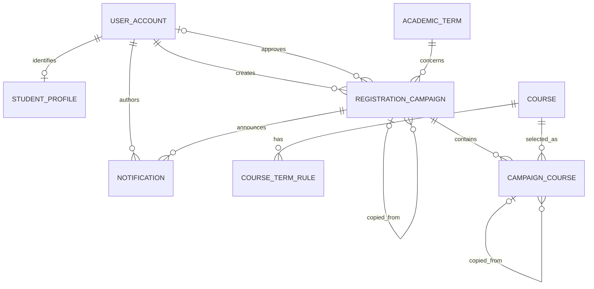

# Use Case 1 conceptual data model

Source: Report.pdf data dictionary, printed pp. 10–12, and UC1,
printed pp. 13–15. This is a proposed model, not an existing schema.

## Report-backed entities
- user_account: user_id PK, username UNIQUE, password_hash,
  full_name, email, role, is_active.
- student_profile: student_id PK/FK -> user_account,
  student_code UNIQUE, program_code, cohort_year, class_code, is_active.
- academic_term: term_id PK, academic_year, term_code,
  term_start_date, term_end_date, status.
- course: course_id PK, course_code UNIQUE, course_name, credits, is_active.
- course_term_rule: rule_id PK, course_id FK, term_code,
  optional program_code, is_active.
- registration_campaign: campaign_id PK, term_id FK,
  registration_open_at, registration_close_at, status,
  copied_from_campaign_id nullable self-FK, created_by FK,
  approved_by nullable FK, approved_at, published_at,
  created_at, updated_at.
- campaign_course: campaign_course_id PK, campaign_id FK, course_id FK,
  copied_from_campaign_course_id nullable self-FK, offering_status.
- notification: notification_id PK, campaign_id FK,
  title, body, published_at, created_by FK.

Adjustment dates from the wider dictionary are deferred beyond UC1.
Approval fields remain tentative until the review workflow is clarified.

## Relationships

The term relationship shows the general dictionary structure.
UC1's duplicate-plan rule proposes a UNIQUE constraint on term_id;
confirm how cancelled plans and multiple rounds should be handled.

## Proposed constraints
- Unique (academic_year, term_code) for academic_term.
- Unique term_id for registration_campaign, subject to the decision above.
- Unique (campaign_id, course_id) for campaign_course.
- registration_close_at > registration_open_at.
- term_end_date > term_start_date.
- Creators and reviewers must have PDT authorization.
- Inheritance must reference a plan of the same semester type.
- Proposed minimal lifecycle: DRAFT -> PUBLISHED, with PDT review
  before publication. A separate APPROVED state needs confirmation.
- Additional dictionary states are not automatically UC1 workflows.

## Missing definitions
- Semester parity is required but has no explicit dictionary field.
  Agree on a term-code mapping or add a semester_type attribute.
- Academic-warning status is required by UC1 but absent from the
  dictionary. Its source and historical scope must be established
  before choosing a field or related table.
- No notification-recipient/read-state entity is specified.
  The minimal proposal treats notification as a shared published
  announcement visible to an agreed student audience.
- If individual delivery or read tracking is required, consider
  notification_recipient(notification_id, student_id, delivered_at,
  read_at), with a unique notification/student pair. This is optional,
  not a report-backed requirement.
- Notification cardinality per publication and correction behavior
  remain unresolved.

No enrollment, registration-result, grade, fee, or timetable entities
are proposed for this use case.
